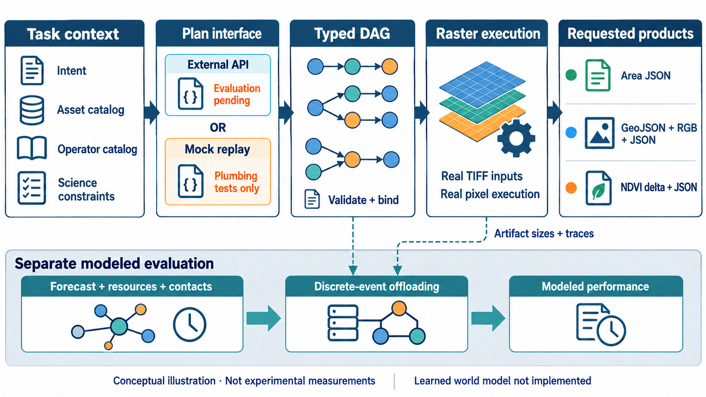
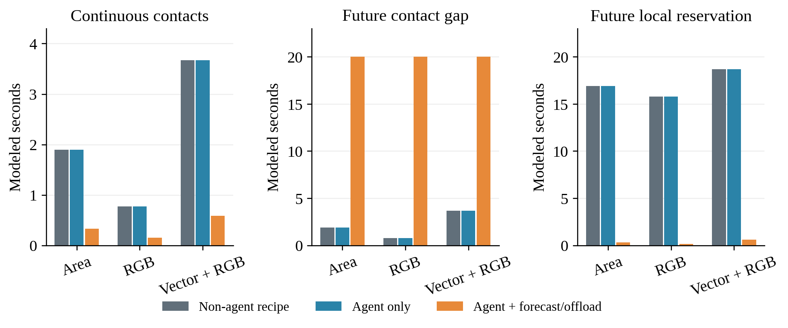
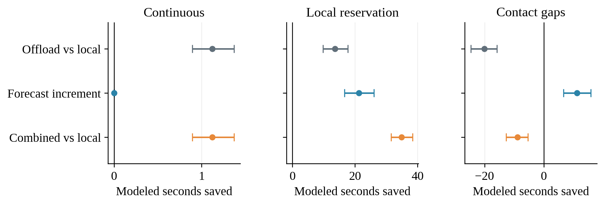
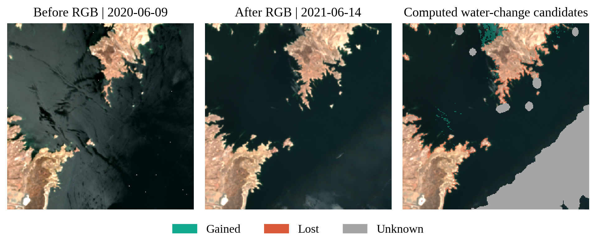
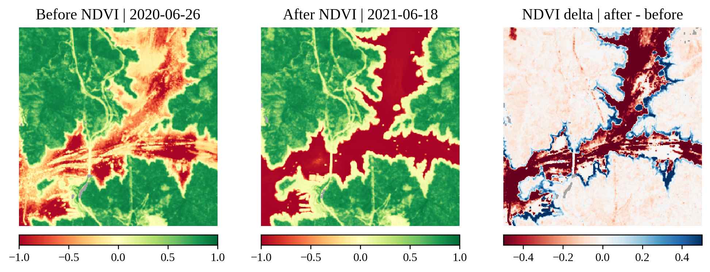
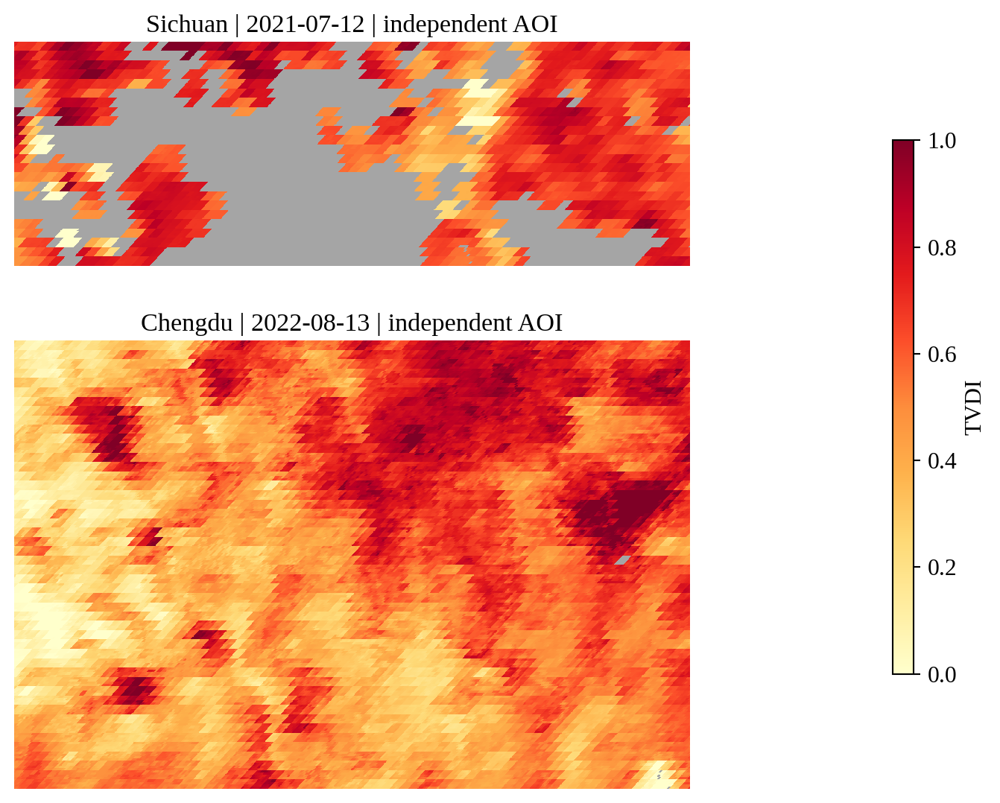

# 目标驱动遥感任务分解与预测协同执行

## OrbitServe Agent 方法设计与原型验证报告

## 2026 年 10 月 17 日

## 研究概述与完成边界

本研究面向遥感任务需求和星地运行环境同时变化的条件，研究如何由业务目标生成可执行的科学子任务及依赖图，再依据资源与接触预测安排执行。核心问题不是把既有任务换一个节点运行，而是先确定完成目标所必需的计算内容、数据依赖和交付产品，然后在不改变科学含义的前提下选择粒度与执行位置。

实验设定：本阶段的Agent计划采用人工参考图的mock回放，遥感算子真实读取TIFF并生成产品；性能比较采用声明资源与接触轨迹的离散事件模型，真实大模型由本地API接口后续替换接入。以下统一称“非Agent”“Agent”“Agent＋预测卸载”，时间表明确区分实测秒与模型秒。已完成可组合工具、外部有类型任务图、科学合同核验和复现入口。

表 1 阶段成果概览

| 研究环节 | 已实现能力 | 主要证据 |

| --- | --- | --- |

| 任务与工具 | 六类九任务、15个科学原语 | 提示词、合同、工具目录 |

| 图执行 | 外部DAG、真实依赖绑定与栅格计算 | 45次合同通过、30项独立检查 |

| 策略评价 | 同图四策略、资源与接触场景 | 配对结果及性能反例 |

| 复现接口 | JSON计划、HTTP适配器、本地API入口 | 源码、测试、请求与产物记录 |

排版说明：DOCX指定中文宋体、英文Times New Roman，正文固定22磅行距，插图段落单倍行距。当前渲染环境未安装两种原字体，PDF以Noto Serif CJK SC和Liberation Serif代替；在安装所需字体的Word环境中可重新导出精确字体版。

## 摘要

本研究建立六类、九个差异化遥感任务，把业务目标约束为算子集合、依赖关系和交付产品，并用资源与接触预测指导执行。45个实际用例均满足合同，生成42次真实产品并正确报告3次缺数据；独立30项功能与公平性检查通过。在预设150个运行环境、1800次配对模型回放中，本地占用族联合方案平均节省95.7%完成时间，预测在同卸载权限下的额外节省为57.1%，95%区间为46.3%至67.4%。常连通时预测增量为零；未来闭链时联合方案仍可能显著慢于强本地基线。结果表明，大收益存在明确条件，全图依赖与最终回传比单步贪心选址更重要。成果包括提示词、可执行图接口、科学产品、统计消融及本地API复现方法。

关键词：任务语义；可执行任务图；遥感算子；预测接口；协同卸载；科学验证；可复现基准

## 一 研究动机与科学问题

### 1 为什么必须先区分任务分解与卸载

遥感用户的目标可能是统计新增水域面积、导出变化多边形、仅生成某一期快视图，或计算植被变化。即使提供同一组影像，不同目标也应决定不同的必要波段、算子、依赖和交付内容。先固定一条水体变化链，再只改变分块数量或执行节点，并不能证明系统理解了这些差异。

表 2 语义分解 空间粒度与执行选址

| 层次 | 回答的问题 | 真正改变的对象 |

| --- | --- | --- |

| 语义任务分解 | 为达成目标必须计算什么 | 算子集合、子任务、依赖、参数及交付 |

| 空间粒度选择 | 既定算子每次处理多少数据 | 窗口、批次、实例数和汇总边界 |

| 执行选址与卸载 | 既定步骤由谁在何时执行 | 节点、准入、等待、传输和重试 |

旧原型的独立反例明确了这一界线：保持真实 Lake Mead 输入和环境不变，仅将任务问题从“计算两期 NDVI 下降面积”改成“计算新增和减少水体并输出多边形与 RGB 叠加图”，两次 plan 调用去掉新生成的 plan_id 后完全相同，均返回 water_tile→water_merge 和固定水体交付。该探针没有运行科学负载，它证明旧规划器未消费任务问题语义；旧图的 whole、128和64切片选择只能归为模板内粒度调整。

### 2 研究问题

问题一是语义约束如何进入图生成。目标、时相、区域、质量规则、公式与交付要求需要被显式编译为有类型的中间产物和依赖，既不能漏算必要步骤，也不能因为默认模板而生成未请求的结果。科学正确性必须能够从图与产物中检验，而不能仅依据模型解释文字。

问题二是结构选择如何适应预测的动态环境。在语义等价的图或空间分解之间，未来可用计算量、存储、能量和接触窗口会改变可行性与交付代价。预测的作用应当在“当前观测相同、未来窗口不同”的成对条件下单独检验，而不是把已知的当前节点忙碌也归功于世界模型。

问题三是高层图规划与局部执行如何配合。图生成提供必须完成的子任务和依赖，运行时仍需依据本地资源和收到的邻居状态做准入、等待与卸载；已有计划不能保证远端当前可接纳。若要证明世界模型本身有贡献，还需要同样允许卸载但不使用预测的对照。

### 3 研究假设的可证伪形式

语义假设：同数据不同目标应产生必要算子和依赖不同的合法任务图。效率假设：省去未请求的计算可能降低开销，但不应期待超过已知目标的最优人工计划。协同假设：在资源或窗口受限条件下，预测与卸载可改变交付可行性或成本；在常连通、资源充足、期限宽松的负对照中，收益可能为零或被规划及通信开销抵消。任何假设都不得通过改变输出质量或遗漏失败样本来兑现。

## 二 技术路线与可执行任务图

技术路线先解决任务目标到科学图的映射，再处理资源适配。任务输入、工具能力与产物类型共同约束规划输出；校验器拒绝不可用算子、悬空依赖、类型不匹配和不满足交付合同的计划；执行器按依赖实际读取像元、计算并落盘；成本模型或真实运行时在给定图上评价执行安排。

AI绘制的技术路线示意。外部计划通过类型与依赖校验后驱动栅格计算；DAG及实际产物大小进入资源、接触和卸载模型。

### 1 输入 输出与验证合同

请求同时给出自然语言指令、必需输出角色、科学定义、时相和目标网格、可见资产及其尺度偏移、工具目录与JSON响应模式。成功计划包含schema_version=1、status=ready、nodes、outputs和rationale；每个节点含唯一id、op、inputs、params，输入端口通过节点ID绑定真实产物。节点可以先于其依赖列出，执行前拓扑排序。缺数据时返回needs_data、明确missing_assets及空图。可选allowed_nodes与not_before_s只约束成本模型的执行安排。

外部计划应被视为不可信输入。执行器必须在运行前校验图无环、依赖存在、工具允许、输入绑定和输出类型一致；交付条件还应检查目标要求的文件和统计口径。规划模型不能直接写最终面积，不能读取参考答案，也不能以解释文本代替计算节点。缺失数据或能力应返回明确状态和原因，而不是悄悄改写科学定义。

### 2 科学原语与语义可组合性

表 3 当前工具合同与执行边界

| 原语组 | 实际操作与产物 | 关键约束 |

| --- | --- | --- |

| load_bands / select_band | 源波段读取；波段集转栅格 | 仅load_bands可打开源影像 |

| index / threshold / difference | 归一化指数、阈值掩膜、双时相差分 | 输入端口类型及参数显式声明 |

| water_change / area_summary | 共同有效变化编码和面积JSON | 未知区不当作非水体 |

| raster_summary / polygonize | 栅格统计；变化多边形 | 矢量面积与栅格支持域核验 |

| rgb / overlay | 真实RGB与候选变化叠加 | 显示支路不改变科学掩膜 |

| 三种mosaic工具 | raster、mask、change空间拼接 | 全网格非重叠、无缺口覆盖 |

| tvdi | NDVI/LST全域拟合与TVDI栅格 | 100个NDVI区间，包含最大值 |

共15个原语。原语执行产生带哈希的中间产物；除源读取外，后续步骤必须消费声明的产物依赖。

新执行器在单台主机上串行执行科学步骤，支持窗口拆分、分支复用及合法mosaic。独立审查使用手工新建的14节点图，将250列划为101列和149列，反向列出依赖、改写case ID并禁用recipe入口后仍能完成真实计算；篡改中间产物则被拒绝。该证据支持外部任务图确实控制数据流，而非用模型输出触发隐藏案例模板。图层同时拒绝无关孤立节点、错误类型、循环、非法窗口和额外交付；科学检查拒绝反时相和错阈值的假成功。

### 3 计划提供与API路径

非Agent路径按目标和产品生成确定性recipe；Agent路径接收独立JSON图，严格执行提交的算子、端口绑定和依赖，不以case ID、目标标签或解释文字替换为隐藏流程。HTTP适配器已通过本地loopback请求、响应解析和计划校验测试。

后续真实API评测应保存请求与响应哈希、模型标识、提示词版本、调用耗时、拒绝和重试记录；密钥只保留在用户本地环境。

## 三 差异化任务与提示词设计

任务族以业务目标差异为中心组织。每个任务都约束相同的输入身份、有效区、分辨率和交付语义，三组方案不得用不同产品要求完成同一个指标。示例任务图只作为评审参考，不能泄漏给待评估 Agent 充当标准答案。

表 4 基准任务族与应观察到的图差异

| 任务案例 | 自然语言目标与科学合同 | 必要图变化 |

| --- | --- | --- |

| 水体面积 | Mead两期MNDWI>0，新增、消退及净面积JSON | 双时相指数→掩膜→变化→面积 |

| 矢量＋RGB | 同水体定义，加变化GeoJSON与后期RGB | 增加polygonize与显示分支 |

| 面积＋RGB组合 | 沿用water_area目标，只加后期RGB，不要矢量 | 同目标标签、不同输出集合 |

| 后期快视 | 仅后期B04/B03/B02，250×250 RGBA | 只load_bands→rgb |

| NDVI下降 | Shasta两期NDVI差，≤−0.15面积与差值栅格 | B08/B04指数→difference→统计 |

| 缺B11严格／替代 | 严格MNDWI返回needs_data；授权后允许NDWI | 权限决定可行性与公式 |

| 两份TVDI | 四川2021及成都2022独立NDVI/LST，TVDI>0.75比例 | 全域拟合，分别产物和统计 |

九个具体案例来自六类任务并含额外产品组合。已有四个NDVI/LST TIFF属于两份独立AOI，不构成同区域时序。参考图不放入模型请求。

### 1 可直接复用的规划提示词

提示词需要同时给出任务请求、输入资产清单、可用工具与类型合同、输出模式及失败规则。可执行的核心要求如下；完整版本以随代码交付的提示词文件为准，评测时固定版本而不针对结果临时调整。

You are an Earth-observation task planner. Infer the required products and their dependencies from the user's instruction. Produce ONE JSON object matching response_schema. Construct your own typed DAG using the operator catalog; nodes become executable pending tasks. Do not return prose, Python, tool calls, or a case ID. There are no hidden tools and no prewritten workflow selected from your answer.
Use only available_assets. Each input reference is the ID of a node whose declared output type matches that input port. Dependencies follow these references. A node may be listed before or after its dependencies; the executor topologically sorts it. Invent meaningful unique node IDs. Reuse intermediate artifacts where appropriate. Source data may be opened only by load_bands; all other operators consume their declared artifact inputs. Output references point at actual nodes. Never invent measurements, acquisition times, missing bands, QA, or resolution. If essential data are unavailable, return status needs_data, nodes=[], outputs={}, and explicit missing_assets. A fallback index is allowed only if the user's instruction authorizes it and your rationale identifies the changed method.
Preserve the requested scientific definitions, thresholds, phase/date support, validity rules, full-AOI TVDI fitting and product requirements. Different requested products may require different operators and graphs. Splitting is optional; if splitting, supply explicit legal windows and mosaic before any full-grid product. Do not sacrifice scientific quality to meet a deadline. Optional predicted_world_state contains modeled forecasts, not certain future truth. Current observations and tool cost profiles may guide decomposition; do not claim optimized results without evidence. Return a short rationale explaining the decomposition, data limitations, and any scheduling constraints. Hardware/contact estimates do not change the pixels or requested quality.

### 2 缺失输入与允许替代必须分开

严格 MNDWI 任务缺少 B11 时，应返回 needs_data 或其他明确不可执行状态；只有用户明确允许 NDWI 替代，才可以选择绿光与近红外形式，并在图参数和最终说明中声明替代。两种指数不能因名字相近而静默互换。本阶段返回明确的缺失资产清单，不自动补齐影像。

TVDI 任务同样要明确拟合支持域。已有 NDVI/LST 产品不能冒充红光与近红外输入；若分块会改变干湿边拟合分布，需先固定全域拟合参数或把全域拟合作为共享依赖，不能在各 tile 重新拟合后声称科学等价。

## 四 实验数据与公平比较协议

### 1 真实数据与科学口径

三个水域区域使用 Earth Search 提供的 Sentinel-2 L2A 双时相 B02、B03、B04、B08、B11 和 SCL，共36 个 TIFF。每个区域为250×250像元、20 m投影网格和25 km²。另有 Earth-Bench question2和question4的NDVI/LST共4 个 TIFF。总缓存40 个 TIFF共5907906字节；水体任务与TVDI任务的样本及计时不得混为一组。

表 5 真实遥感输入

| 区域 | 前时相 | 后时相 | 投影 |

| --- | --- | --- | --- |

| Lake Mead | 2020-06-09 | 2021-06-14 | EPSG:32611 |

| Lake Powell | 2020-06-11 | 2021-06-21 | EPSG:32612 |

| Shasta Lake | 2020-06-26 | 2021-06-18 | EPSG:32610 |

物理值按每个资产的scale与offset应用一次，连续波段与分类质量层分别按合适规则重采样。两期变化只在共同有效区域内统计，云、阴影、无数据保留为未知。水域候选使用固定 MNDWI>0；面积按投影网格计算。输出一致性或独立复算通过，不等于经外部标签验证了分类精度或洪水识别准确率。

MNDWI=(B03−B11)/(B03＋B11)，NDVI=(B08−B04)/(B08＋B04)；授权替代的NDWI=(B03−B08)/(B03＋B08)。指数要求必要波段有限、分母非零，并采用SCL类别4、5、6、7。两期掩膜的共同有效支持域内，前期非水而后期水为新增，反之为消退；20 m像元面积为400 m²，净面积为新增减消退。

TVDI=[LST−LSTmin(NDVI)]/[LSTmax(NDVI)−LSTmin(NDVI)]。按全AOI的100个等宽NDVI区间（含最大值）分别取温度极值，用不加权OLS拟合干湿边；非正温差跨度设无效，结果截断到0至1，再统计TVDI>0.75的有效像元比例。RGB仅用于显示，采用固定0至0.3拉伸与无数据透明度，不参与水体或植被指数判定。

### 2 三组主方案与强基线

表 6 比较方案及其公平边界

| 方案 | 图生成 | 执行信息 | 解释范围 |

| --- | --- | --- | --- |

| 非Agent | 目标匹配的人工或确定性正确图 | 预先声明的固定执行规则 | 不能用无视目标的旧水体模板充当唯一基线 |

| Agent only | 同一提示词协议生成语义图 | 不使用未来预测的预设执行条件 | 重点检验任务适配、有效性及规划开销 |

| Agent 加预测和卸载 | 相同语义合同或等价图 | 预测资源与接触条件、允许协同 | 联合差值不自动等于WM单独收益 |

| 必要消融 | 固定同一语义图 | 允许卸载但移除未来预测 | 隔离预测信息的条件价值 |

非Agent应按每个目标正确完成相同产品合同。固定“所有工具都跑一遍”的万能流程可作为冗余成本对照，但不能替代目标匹配的强基线。若 Agent 生成与人工计划完全相同的图，在相同执行条件下没有理由保证计算更快，且会额外产生规划调用成本；此结果应如实报告。

### 3 区分预测价值的场景

normal为常连通和宽松期限对照；future_contact初始链路同样可用，但0.025秒后关闭，20秒后恢复；busy_local在0.2至15秒保留本地A资源。所有时间均为声明模型时间。除三组主方案外，固定同一真实执行图和产物大小，分别回放local/current、local/forecast、dynamic/current与dynamic/forecast，分离选址权限与未来信息。无预测策略遇闭链可等待实际接触事件后重评，不将暂时闭链人为算作物理不可行。

建议对期限和链路容量做连续或网格敏感性分析，而不是只挑能让联合方案获胜的参数点。所有方案使用同一任务、数据、输出合同和外部资源轨迹；若需要归因，分别固定语义图、分解和执行策略进行消融。成功率、失败类别与未完成任务必须保留在分母中。

### 4 分层评价指标

先评估语义有效性：所选算子、依赖和交付是否回应目标；再评估可执行性：类型、资源和数据绑定是否成立；再评估产物正确性：实际文件、像元、统计及来源是否可独立核验。只有在相同正确输出约束下，才比较模型时间或真实墙钟、传输、规划开销和期限完成情况。模型时间、主机墙钟、模型能耗、实际进程观测分别列示。

## 五 实际运行结果与证据核验

### 1 语义任务管线的实际覆盖

最终冻结批次normal-final含9案例×3方案共27次运行；focused-final含3案例×2约束场景×3方案共18次，共45次。42次生成科学产品，3次严格缺B11请求正确返回needs_data；45次均通过合同检查。每一案例、方案、场景仅一次确定性运行，属于功能与机制展示，不具备重复实验的统计推断条件。

表 7 任务请求 计划与实际产物核验

| 案例 | 节点数 | 输出角色 | 实际算子秒 | 产品字节 |

| --- | --- | --- | --- | --- |

| 水体面积 | 8 | summary | 0.1762 | 482 |

| 水体矢量＋RGB | 11 | polygons, rgb, summary | 0.3455 | 567627 |

| 面积＋RGB组合 | 10 | rgb, summary | 0.2727 | 273793 |

| 后期RGB快视 | 2 | rgb | 0.1187 | 273311 |

| NDVI下降 | 6 | delta, summary | 0.1921 | 691283 |

| 严格缺B11 | 0 | needs_data | — | — |

| 允许NDWI替代 | 8 | summary | 0.1580 | 511 |

| 四川TVDI | 5 | summary, tvdi | 0.8740 | 1024388 |

| 成都TVDI | 5 | summary, tvdi | 2.1553 | 3362512 |

展示normal-final中Agent组的单次代表运行；全部三组合同结论相同。算子秒为本地真实耗时之和；产品字节为请求产物的数据文件大小。needs_data不计为科学交付。

模型时间与主机计时分开保存：actual_execution_wall_s包括校验、独立科学复算、执行、记账及模型回放，排除API规划；actual_tool_wall_s为算子耗时之和。nominal_source_file_bytes是每次load所引用完整源文件大小之和，既不是OS实际磁盘IO，也不是窗口解码字节。产物包大小包含实际数据文件，不含artifact.json。模型使用科学执行后已知的中间产物大小进行离线反事实回放，各策略共享同一信息，不能据此声称在线Agent或WM已学会预测中间量。

### 2 图结构差异的实例

同一Mead输入，“仅后期RGB”对应2节点，水体面积对应8节点，水体矢量与RGB对应11节点。差异发生在真实算子和依赖：快视图无需前期影像或指数，矢量图需要变化栅格与polygonize，不能靠重命名water_tile实现。

“面积＋RGB”与“仅面积”具有相同water_area目标标签，却分别需要10节点和8节点；外部图可显式增加显示支路而不执行多边形支路。NDVI下降采用另一组波段和差分统计链。严格缺B11的空图保持请求的summary需求，通过缺数据状态解释无法交付，而不是伪造零面积。

### 3 成本模型比较

模型有A/C两个计算节点，源数据位于A，必需产物返回A视为完成。配置工作速率A为500000、C为4000000单位/秒，带宽20000000字节/秒，延迟0.005秒、算子启动0.01秒，内存预算各512 MiB。算子计算时长=像元数×工具工作系数/节点速率＋启动时间；依赖与源文件传输按字节/带宽、固定延迟及接触等待计算，并满足节点队列和资源保留约束。逐节点比较候选完成时刻并取较小者；当前步骤若直接产生必需产品，其返回A的时间计入评分，后继全路径不做联合最优求解。模型使用科学执行后已知的产物大小，预测等于声明真值，属于理想信息条件；未校准硬件，未计API规划延迟与费用、独立A→G下行、全局链路争用和丢包。表8、9及后续统计统一采用v2重放：当前策略可见已发生占用及释放时刻，预测策略还可见未开始事件。原45次科学记录与v2回放分开归档。

表 8 声明参数下的模型比较

| 场景／任务 | 非Agent
模型秒 | Agent
模型秒 | Agent＋预测卸载
模型秒 |

| --- | --- | --- | --- |

| 常连通／水体面积 | 1.8925 | 1.8925 | 0.3268 |

| 常连通／后期RGB快视 | 0.7700 | 0.7700 | 0.1560 |

| 常连通／水体矢量＋RGB | 3.6725 | 3.6725 | 0.5902 |

| 未来闭链／水体面积 | 1.8925 | 1.8925 | 20.0050 |

| 未来闭链／后期RGB快视 | 0.7700 | 0.7700 | 20.0187 |

| 未来闭链／水体矢量＋RGB | 3.6725 | 3.6725 | 20.0197 |

| 未来本地占用／水体面积 | 16.8925 | 16.8925 | 0.3268 |

| 未来本地占用／后期RGB快视 | 15.7700 | 15.7700 | 0.1560 |

| 未来本地占用／水体矢量＋RGB | 18.6725 | 18.6725 | 0.5902 |

| 常连通／四川TVDI | 113.9474 | 113.9474 | 14.3262 |

| 常连通／成都TVDI | 227.8447 | 227.8447 | 28.6067 |

同一目标、同一图及产物合同；默认期限60模型秒。两套主批次每个条件运行一次，缺数据单列；后续分布实验按预设随机场景采样。

表 9 同图上的预测与卸载消融 水体面积任务

| 场景 | 本地／当前 | 本地／预测 | 动态／当前 | 动态／预测 |

| --- | --- | --- | --- | --- |

| 常连通 | 1.8925 | 1.8925 | 0.3268 | 0.3268 |

| 未来闭链 | 1.8925 | 1.8925 | 20.0228 | 20.0050 |

| 未来本地占用 | 16.8925 | 16.8925 | 0.3268 | 0.3268 |

单位为模型秒。所有策略消费同一真实产物大小。无预测动态策略可以等待链路恢复；此表是模型回放，不增加实际科学运行次数。

常连通和未来本地占用条件下，动态执行降低了这组模型成本，但同动作集合的预测边际贡献为零，不能把联合差值全归功于WM。未来接触中断是明确负例：贪心预测方案将前段步骤放到远端，未充分考虑后续依赖和最终回传窗口，水体面积完成20.0050模型秒，远慢于全本地1.8925秒。无预测但支持事件等待的动态对照也能约20.0228秒完成；二者差仅约0.0178秒，而非可行与不可行。手写allowed_nodes=[A]的导入图保留同一科学结果并恢复1.8925秒；busy_local手写约束C可达0.3268秒，对照本地16.8925秒。这些构造图给出了全图规划需要识别的决策边界。

三幅分别为常连通、未来接触间隙和未来本地保留。纵轴为模型秒；每个任务三组输出合同相同。未来接触场景保留联合方案明显更慢的负例。

### 4 运行环境分布与性能幅度

为检验收益幅度而非停留于单一参数点，在执行前固定seed=20261017，每族独立抽取50个运行环境，共150个world；每world以相同资源与接触轨迹运行水体面积、RGB、矢量＋RGB三个真实DAG的四种策略，共1800次离线回放。A速率为25万至100万单位/秒、C/A为0.5至12、带宽为0.2至50 MB/s，均按对数均匀抽样；占用起点0.02至0.15秒、时长10至60秒，首接触0.01至0.2秒、闭链5至60秒，按均匀分布抽样。负结果和超期结果全部保留。

相对节省=100×(对照完成时间−比较完成时间)/对照完成时间。先在world内对三个产品等权平均，再跨50个world求均值；按world整簇重抽样5000次，bootstrap seed=20261018，取逐项95%百分位区间（非多重比较同时区间）。独立样本量为每族50，非150个产品或450次运行。区间只描述声明合成参数分布的Monte Carlo不确定性，不扩展为实际卫星总体。

表 10 150个运行环境的配对时间节省

| 场景族 | 卸载对本地 | 预测对动态当前 | 预测卸载对本地 |

| --- | --- | --- | --- |

| 常连通 | 37.5%
[31.5, 44.0] | 0.0%
[0.0, 0.0] | 37.5%
[31.5, 44.0] |

| 未来本地占用 | 40.3%
[29.6, 51.1] | 57.1%
[46.3, 67.4] | 95.7%
[94.8, 96.5] |

| 未来闭链 | -1111.5%
[-1417.3, -835.3] | 30.2%
[20.5, 40.1] | -602.9%
[-905.6, -343.7] |

每格为平均相对节省及95%区间；正值更快，负值更慢。各族n=50 world，三产品按world内等权汇总。

未来本地占用族的联合方案平均节省95.7%模型时间（95%区间94.8%至96.5%），平均节省34.91秒。单独允许卸载节省40.3%（29.6%至51.1%）；在同样允许卸载后增加预测，进一步节省57.1%（46.3%至67.4%），对应21.28秒。联合对本地的全部150个产品配对均超过10%改进，预测对动态当前策略有60.7%的配对超过10%改进。两类百分比使用不同对照，不能直接相加。

常连通族的预测增量为0，联合节省37.5%来自执行选址。未来闭链族中，预测相对无预测动态策略平均节省30.2%（20.5%至40.1%），但联合方案相对强本地基线仍平均增加8.90模型秒，相对节省为−602.9%（−905.6%至−343.7%），37.3%的产品配对退化超过10%。较短本地任务使相对退化幅度很大，因此同时报告绝对秒差。该结果把研究重点指向全DAG依赖和回传窗口的联合规划。

点为平均配对模型秒差，横线为world整簇95%区间；正值为节省，负值为退化。联合效果与预测边际效果使用不同对照。

固定60模型秒期限下，本地占用族本地策略147/150按期、动态当前149/150、动态预测150/150；全部任务最终完成。常连通与未来闭链族各策略均150/150按期，因此本批主要证据是完成时间差异，不能把宽松期限下的满完成率解释成普适可行性优势。更紧期限网格属于后续敏感性扩展。

### 5 旧四节点实测的保留范围

旧空间粒度与执行选址矩阵在需求更新后停止，共保留51个结果：48次真实交付和3次低内存整块预检不可行。仅完成第一轮技术运行，后续重复及强整块动态补充未执行，作为单次描述性证据保留。独立审阅对保留证据完成3877项检查，包含原始时间、数据字节、科学像元重建及跨组一致性。

例如Mead正常场景中，固定128分块＋固定B交付5.370秒、负载6636739字节；粒度自适应＋固定B为5.262秒、6380067字节；固定128＋动态B/C为5.533秒、8279581字节；粒度自适应＋动态B/C为5.288秒、6380067字节。固定整幅＋固定B约5.195秒，同样6380067字节，说明正常场景下强整幅基线并不劣。这里的墙钟来自地面已验证交付时间，负载来自真实字节传送记录，与新语义层模型指标不可直接横比。

这些结果证明固定科学流程的隔离执行、真实传输和状态扰动响应，仍然不证明语义任务分解。旧执行中的动态改派针对新就绪步骤，不是迁移运行中进程；compute_pixels_s仅参与评分，实际CPU未按异构参数节流；内存与能量是应用预算模型。新语义执行器与旧四节点运行时的集成程度必须按实际代码与证据分别陈述。

## 六 真实遥感产品与结果解释

本节图像全部来自最终normal-final的新语义执行产物或同批源波段的定量显示，图1概念示意除外。相同任务三组使用相同科学合同，代表图不表示调度方式改变了遥感现象。水体有效性仅依赖指数所需B03/B11及SCL，NDVI依赖B04/B08及SCL；旧V0还要求额外显示波段有效，因此Mead新统计51884有效像元和583新增像元，与旧51877和580的差别来自有效区合同，不能归功于调度或Agent。

表 11 新语义任务的科学统计

| 产品 | 共同有效像元 | 实际结果 | 解释口径 |

| --- | --- | --- | --- |

| Mead水体变化 | 51884 / 62500 | 新增0.2332、消退0.7220、净−0.4888 km² | MNDWI>0；未知4.2464 km² |

| Shasta NDVI差 | 62228 / 62500 | 均值−0.099856；下降面积4.9840 km² | 差值≤−0.15占有效区20.0231% |

| 四川TVDI | 1307762 / 2242074 | TVDI>0.75：367090像元，28.0701% | 2021-07-12独立AOI |

| 成都TVDI | 4482532 / 4484148 | TVDI>0.75：669532像元，14.9365% | 2022-08-13独立AOI |

面积仅指请求AOI和有效支持域。阈值候选不是外部真值，不能据此声明洪水或植被损失分类精度。

### 1 Lake Mead 双时相与变化产品

2020-06-09至2021-06-14；250×250像元，20 m网格。左图由相同源B04/B03/B02按资产scale/offset重建用于展示，后期RGB和变化层来自最终执行产物。固定0至0.3显示拉伸；绿为新增，橙红为消退，灰为未知，变化叠加透明度50%。RGB显示有效性与水体共同有效区分别处理。

右下明显未知区保留在结果中，不能裁掉或描述为“无变化”。本任务有效覆盖率83.0144%，净变化−0.4888 km²只属于有效AOI，不等于整个Mead水库面积变化，也不直接归因于某次洪水、降水或调水事件。

### 2 Shasta 植被指数差值产品

2020-06-26至2021-06-18；实际B08/B04计算，250×250像元、20 m网格。前两幅采用相同−1至1色标；右幅为后期减前期，共同有效区域外显示灰色，色标截取−0.5至0.5仅用于可视化。统计基于完整实际值。

共同有效区NDVI差均值约−0.099856，差值≤−0.15占20.0231%。该指数变化包含季节、地表覆盖、水域及观测条件的综合影响，不能直接解释为已验证的植被损失。图中的变化说明用户目标改为NDVI后确实执行了不同谱段和算子，而非仍返回水体图。

### 3 两份独立TVDI产品

上图四川2021-07-12，2598×863；下图成都2022-08-13，2598×1726。灰色为无效或缺测像元；各自按全AOI拟合干湿边，色标0至1。两者位置及网格不同，不作前后像元差分。原NDVI与LST产品物理分辨率分别为250 m与1 km，30 m导出网格不代表获得30 m真实信息。

## 七 理论区分条件 负对照与局限

### 1 什么情形能区分三组方案

任务差异可以区分语义适配能力：仅请求后期RGB时，必要图不应执行前期波段读取、MNDWI和变化矢量；NDVI下降面积任务不应返回水体目标。若与全工具万能流水线相比，减少无关节点可降低开销，但面对同目标的正确人工计划，模型可能只增加规划开销。故任务适配和性能优势应分开报告。

未来窗口差异可以区分预测的条件价值：相同当前链路可用状态，不同后续接触闭合时刻，可能使“等待高算力节点”“提前传输”“本地先处理后传摘要”等选择的可行性不同。需要两种执行策略具有相同可用动作并面对同一真实轨迹，才能把差值归因于预测信息，而不是给联合组额外权限或更好的数据。

资源约束可以区分分解与卸载：若所有可达节点都容不下整块工作，仅更换节点不能解决准入，等价空间分块才改变可行性。反之，当前节点忙碌而邻居空闲时，换执行位置即可获益，这属于卸载；不能把它说成产生了新的科学子任务。

### 2 必须保留的负对照

常连通、资源充足、期限宽松时，预测可能不改变行动，额外规划与传输也可能抵消收益。后续泛化测试应留出未预置但合法的工具组合、交付删选与条件约束，并与正确的目标匹配流程比较。

### 3 本阶段仍未验证的能力

本阶段的结论覆盖可执行图接口、真实科学计算和声明场景下的策略机制；自主规划成功率、未见任务泛化、API开销和学习预测误差由后续真实模型评测建立。新语义DAG当前在单主机串行执行，接入旧四进程运行时、真实轨道链路和硬件功耗校准仍是后续任务。当前15个工具限制了可表达任务空间。

遥感层面，三个小型湖岸AOI不足以代表全球地表场景；水体结果是固定阈值候选，没有洪水真值或外部精度评价。TVDI的question2与question4区域、日期及网格不同，属于两份独立产品任务，不能组成像元级时序变化分析。轨道、无线链路、硬件功耗及真实异构算力仍需另行校准。

### 4 下一阶段建议验收

建议先在用户本地真实API上验证提示词与输出约束，逐任务记录语义有效、可执行、产物正确及失败原因；再增加留出组合和表达扰动，检验计划是否依赖固定案例答案。随后将通过科学检查的同一图接入预测与卸载消融，固定数据与外部轨迹，比较期限完成率和开销。只有同时满足这些要求，才适合将“目标驱动Agent分解有效”和“预测协同提高性能”分别写为验证结论。

## 八 本地API复现与成果交付

### 1 复现步骤

在代码仓库根目录使用独立Python环境安装requirements-lock.txt及可编辑包，按数据获取脚本准备缓存；数据与运行目录置于仓库外。先用fixture模式检查依赖和科学结果，再在用户本地配置真实API并为每个场景、每种预测可见性分别生成计划。以下命令与docs/semantic_harness.md一致，输出目录必须为空。

python -m pip install -r requirements-lock.txt

python -m pip install --no-deps -e .

export ORBITSERVE_DATA_ROOT="$HOME/.cache/orbitserve/data"

python scripts/prepare_data.py --data-root "$ORBITSERVE_DATA_ROOT"

python scripts/run_semantic_comparison.py --mode fixtures --scenario normal --run-root runs/fixture-normal --model-controls

python scripts/run_semantic.py export-request --case-id water_area_mead --arm agent_only --output requests/area.json

python scripts/run_semantic.py call-api --case-id water_area_mead --arm agent_only --output plans/water_area_mead__normal__agent_only.json

python scripts/run_semantic.py call-api --case-id water_area_mead --arm agent_wm_offload --output plans/water_area_mead__normal__agent_wm_offload.json

python scripts/run_semantic_comparison.py --mode external --plans-dir plans --case-id water_area_mead --scenario normal --run-root runs/real-agent-area --model-controls

真实调用前，仅在用户本地环境设置ORBITSERVE_API_KEY、完整chat/completions端点ORBITSERVE_API_ENDPOINT及模型ORBITSERVE_API_MODEL；不要把密钥写入JSON、命令参数、报告或Git。远程端点要求HTTPS，禁止重定向；仅localhost允许HTTP。适配器使用JSON-object响应和temperature=0，供应商不支持时应显式报错，不回落成mock。保存请求、计划与planning sidecar用于记录延迟和usage。未来场景需同时传入--scenario，计划文件名必须带CASE_ID__SCENARIO__agent_only或agent_wm_offload，避免跨场景误用计划。

### 2 产物与代码定位

表 12 交付内容与用途

| 交付项 | 定位与内容 |

| --- | --- |

| 科学与计划代码 | src/orbitserve/semantic.py、semantic_ops.py、semantic_quality.py、semantic_model.py |

| 脚本与案例 | scripts/run_semantic.py、run_semantic_comparison.py；configs/semantic_cases.json |

| 提示词与合同 | system_prompt.txt、tool_catalog.json、response_schema.json及requests/、fixtures/ |

| 最终运行证据 | normal-final/与focused-final/：manifest、metrics、model_controls/effects、每run计划和真实产物 |

| 统计与模型重放 | model-v2-replay/；world-sweep：预设协议、150world、1800轨迹、效应及整簇CI |

| 功能与反例审查 | final-freeze/semantic_audit.json；semantic_invariance_probe.json；manual witnesses |

| 报告与图件 | DOCX、PDF、可编辑Markdown/JSON、重建脚本、实际数据图和标注AI概念图 |

独立审查共30项功能与公平性检查通过，覆盖任意合法新图、真实中间依赖、负面输入、提示词不含既定替代答案、严格缺数据请求及无预测等待机制。统计独立复核另通过16项检查，复算240个效应量及480个区间端点一致。最终两套矩阵冻结同版源码与案例快照并记录哈希。旧中止矩阵、早期试运行和最终运行分目录保存；结论仅引用明确标记的最终批次。代码与报告由项目主流程归档到GitHub，原始影像及完整结果由项目主流程归档到Google Drive；共享位置以最终交付清单为准。

### 3 总结

本阶段完成了目标差异到科学数据流的可执行接口、真实产品与策略评估基准。资源占用条件下联合方案具有大幅模型收益，常连通预测增量为零，闭链负例则揭示全图规划的必要性。后续重点是让真实Agent稳定识别这些任务结构与执行边界，并在校准环境中验证。

## 参考资料与证据索引

[1] Sandholt I, Rasmussen K, Andersen J A. A simple interpretation of the surface temperature/vegetation index space for assessment of surface moisture status. Remote Sensing of Environment, 2002, 79(2–3): 213–224. DOI: 10.1016/S0034-4257(01)00274-7. https://orbit.dtu.dk/en/publications/a-simple-interpretation-of-the-surface-temperaturevegetation-inde/

[2] Xu H Q. A Study on Information Extraction of Water Body with the Modified Normalized Difference Water Index (MNDWI). Journal of Remote Sensing, 2005(5): 589–595. DOI: 10.11834/jrs.20050586. https://www.ygxb.ac.cn/en/article/10644694

[3] Copernicus SentiWiki. S2 Processing. Sentinel-2 Level-2A及SCL说明。https://sentiwiki.copernicus.eu/web/s2-processing （查阅日期2026-10-17）

[4] Element84. Baseline 4.0 Offset Issue #9. 源方关于BOA偏移标记与遗留offset字段不一致的说明。https://github.com/Element84/earth-search/issues/9 （查阅日期2026-10-17）

[5] OpenDataLab. Earth-Agent官方实现，固定参考版本 ca1dfaef750654331308a434966d307f1728fd90。https://github.com/opendatalab/Earth-Agent

[6] Sssunset. Earth-Bench公开数据，固定版本49ce6b784c038b63b0817cbfa8211eb053b47e37，实际输入来源及SHA-256见获取清单。https://huggingface.co/datasets/Sssunset/Earth-Bench

[7] OrbitServe-Agent源码及技术文档。https://github.com/ZhiweiWei-NAMI/OrbitServe-Agent。科学、数据、运行时与语义层的文件索引见表12及随附证据清单。

[8] 旧模板语义不变探针 semantic_invariance_probe.json；中止的空间粒度与执行位置比较 protocol.json、stop_notice.json、runs.csv、execution_audit.json。只按实际保留范围使用。

[9] 最终语义基准normal-final、focused-final的study_manifest.json、metrics.json、model_controls.json、model_effects.json与各run/result.json；final-freeze/semantic_audit.json；witnesses/summary.json。所有数字以随附冻结证据为准。 模型v2回放model-v2-replay/model_controls.json；统计分布protocol.json、worlds.json、summary.json、effects.csv和raw_results.jsonl，模型哈希61f22370e3773d6d469d833570e08b2c3b4951f71cf21e1ff7d99586f35cb6e8。 统计独立复核见statistical-review/world_sweep_audit.json（16项通过）。